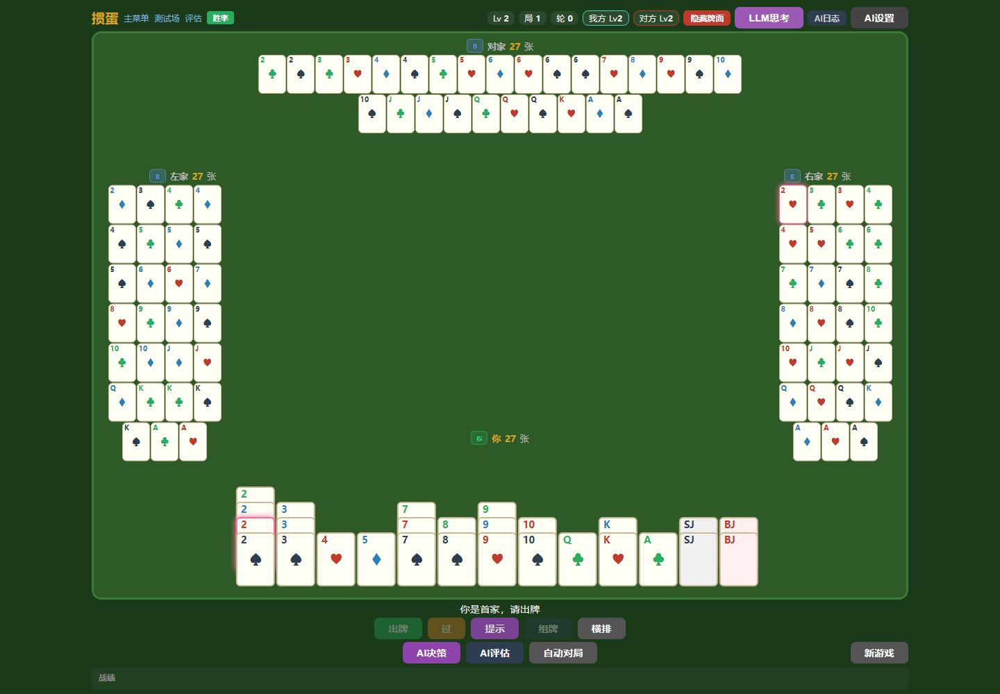
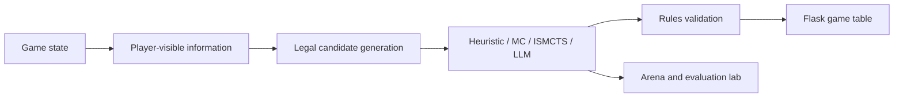

# Guandan Intelligent

**A Guandan game engine and decision laboratory.** Play against AI, inspect legal choices and compare heuristic, Monte Carlo, ISMCTS and optional language-model agents.

[简体中文](README.zh-CN.md) · [Agent source](guandan/ai/) · [Documentation history](docs/README-history.md)



*Actual browser capture of public revision `88bdabc`, using generated cards and local blind heuristic agents. The original debug view displays all hands; no model API was called. [Capture and reproduction](docs/showcase/README.md).*



*Architecture diagram of the implemented workflow, not a gameplay screenshot or a benchmark result.*

## Explore

| Area | Purpose |
|---|---|
| Game table | Human vs AI play, hints, configuration and action logs |
| Arena | Compare agents on defined hands and scenarios |
| Evaluation lab | Seeded self-play, benchmark history, Elo, tuning and regression tools |
| Agent system | Separate player information, legal candidates, scoring and decision strategies |

## Run locally

Use Python **3.11+**, from the repository root:

```bash
python -m pip install -r requirements.txt
python -m guandan.ui.web.app
```

Open `http://127.0.0.1:8765`. The normal local agents do not need an external model service. The optional DeepSeek agent takes `DEEPSEEK_API_KEY` from the environment; configure it only when selecting that agent. Never commit API keys or local `config.json`.

```bash
python -m pytest
```

Browser checks are in `tools/`; their existing Playwright setup is separate from ordinary gameplay. The screenshot uses the existing local dependencies and a heuristic-only isolated run; no new benchmark was run.

## Read the implementation

- `guandan/`: cards, combinations, rules, game state, scoring and tribute flow.
- `guandan/ai/`: player views, candidate generation, scoring and pluggable deciders.
- `guandan/arena/` and `guandan/eval/`: scenarios, self-play, metrics and experiment tools.
- `guandan/ui/web/`: Flask routes, templates and browser code.
- [Agent source](guandan/ai/): inspect player-view and decision interfaces before adding an algorithm.

## Status and boundaries

An experimental decision system under development. Rule variants and approximations must be checked against the chosen competition rules; the older README's blanket “complete official rules” description is not a certification. Local fixes can be ahead of the public snapshot. Monte Carlo estimates and Elo depend on their seed set, opponents and evaluation budget, and are not claims of human-level or competitive superiority.

Run the Flask application as a single process: game sessions, jobs and locks are in memory. Local configuration and evaluation history belong to the deployment. The LLM integration can incur provider charges and may fall back to a heuristic agent when unavailable; inspect the selected configuration and logs.

## Source and license

Original project history and detailed earlier usage are linked in [documentation history](docs/README-history.md). No repository-wide open-source license is declared in the public baseline. The separately vendored `third_party/danlm_bots` retains its own notices and license; it does not license this whole repository.
