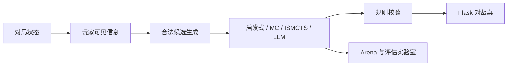

# 掼蛋智能分析引擎

**掼蛋游戏引擎与 AI 决策实验室。** 可以人机对战、检查合法候选，并对比启发式、蒙特卡洛、ISMCTS 与可选大模型智能体。

[English](README.md) · [智能体源码](guandan/ai/) · [文档历史](docs/README-history.md)


*公开版本 `88bdabc` 的实际浏览器截图，使用程序发牌与本地盲评启发式智能体。原有调试视图显示全部手牌，未调用模型 API。[拍摄与复现](docs/showcase/README.md)。*



*图示对应已有实现流程，不是游戏截图或基准测试结果。*

## 功能入口

| 区域 | 用途 |
|---|---|
| 对战桌 | 人机对战、提示、配置与出牌日志 |
| Arena | 在固定手牌和场景上比较智能体 |
| Eval Lab | 固定种子自对弈、历史、Elo、调参与回归工具 |
| AI 系统 | 分开管理玩家信息、合法候选、评分与决策策略 |

## 本机运行

需要 Python **3.11+**，在仓库根目录执行：

```bash
python -m pip install -r requirements.txt
python -m guandan.ui.web.app
```

打开 `http://127.0.0.1:8765`。普通本地智能体不需要模型服务；可选 DeepSeek 智能体从环境变量 `DEEPSEEK_API_KEY` 读取密钥，仅在选用时配置。密钥和本机 `config.json` 不应进入 Git。

```bash
python -m pytest
```

浏览器检查位于 `tools/`，已有 Playwright 环境与普通游戏运行分开。截图复用已有本机依赖，在隔离副本中仅运行启发式智能体，没有重跑 AI 基准。

## 阅读源码

- `guandan/`：卡牌、组合、规则、状态、计分与进贡流程。
- `guandan/ai/`：玩家视角、候选枚举、评分及可插拔决策器。
- `guandan/arena/`、`guandan/eval/`：场景、自对弈、指标及实验工具。
- `guandan/ui/web/`：Flask 路由、模板和前端。
- [智能体源码](guandan/ai/)：新增算法前先核对玩家视角与决策接口。

## 状态与边界

项目是持续开发中的实验决策系统。具体规则变体和简化应对照所选赛事规则核验，旧说明中的“完整官方规则”不是认证；本机修正可能领先于公开快照。蒙特卡洛估计和 Elo 依赖种子、对手及预算，不表示已达到人类或竞技顶级水平。

Flask 按单进程运行：对局、评估任务和锁保存在进程内。本机配置和评估历史归属于部署环境。LLM 模式可能产生服务商费用，不可用时可能回退启发式智能体，需核对配置与日志。

本机若已有统一服务控制器，按其登记方式启停；公开用法以上述 Python 模块入口为准。

## 来源与许可

原有历史与详细旧用法见 [文档历史](docs/README-history.md)。公开基线未声明仓库整体的开源许可证。`third_party/danlm_bots` 自带的来源和许可单独适用，不能据此推定整个仓库的许可。
